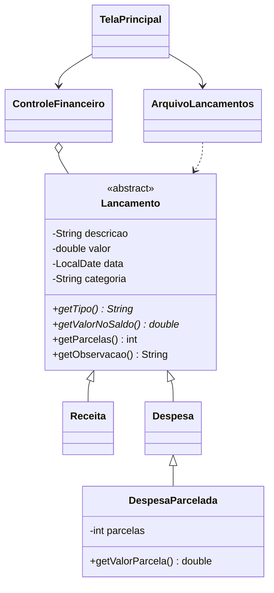

# Controle Financeiro

Trabalho de **Linguagem de Programação Orientada a Objetos** (FAESA, 2026/2, turma 4HC1, Prof. Cinthia Caliari).

Programa em Java para controlar o orçamento: o usuário lança receitas, despesas e despesas parceladas, e o sistema mostra o saldo e o total gasto por categoria. Os dados ficam gravados em um arquivo `.csv`.

O tema é uma parte do **Jarvis Financeiro**, o projeto do grupo em Projeto Integrador IV, refeita em Java puro para aplicar os conceitos da disciplina.

## Integrantes

- Gabriel Dazilio Fanchiotti
- (nome)
- (nome)
- (nome)

## Onde está cada conceito pedido

| Conceito | Onde está no código |
|---|---|
| **Herança** | `Lancamento` (abstrata) é a classe base. `Receita` e `Despesa` herdam dela, e `DespesaParcelada` herda de `Despesa`. |
| **Polimorfismo** | `getValorNoSaldo()` e `getTipo()` são abstratos em `Lancamento` e cada subclasse responde do seu jeito. `ControleFinanceiro.calcularSaldo()` percorre uma `ArrayList<Lancamento>` sem perguntar a classe de cada objeto. `DespesaParcelada` ainda sobrescreve `getParcelas()` e `getObservacao()`. |
| **Tratamento de exceção** | `LancamentoInvalidoException` é a exceção do sistema, lançada com `throw` nos construtores quando um dado está errado. A tela trata com `try/catch` em `adicionarLancamento()`. `NumberFormatException` e `DateTimeParseException` são capturadas e convertidas. A leitura e a gravação tratam `IOException` e usam `finally` para fechar o arquivo. |
| **Coleções** | `ArrayList<Lancamento>` guarda os lançamentos e é ordenada com `Collections.sort` (a classe `Lancamento` implementa `Comparable`). `TreeMap<String, Double>` soma as despesas por categoria. |
| **Leitura e gravação** | `ArquivoLancamentos` lê e grava `dados/lancamentos.csv`. O arquivo é lido quando o programa abre e regravado a cada inclusão ou remoção. |
| **Interface gráfica** | `TelaPrincipal` (Swing): formulário, tabela, resumo e janelas de aviso. |

## Classes

Todas ficam no pacote `TrabFinal`, uma por arquivo.

| Classe | Responsabilidade |
|---|---|
| `Main` | Abre a tela. |
| `TelaPrincipal` | Interface gráfica e eventos dos botões. |
| `ControleFinanceiro` | Lista de lançamentos e contas (totais, saldo, resumo por categoria). |
| `ArquivoLancamentos` | Leitura e gravação do `.csv`. |
| `Lancamento` | Classe abstrata com os dados comuns e as validações. |
| `Receita`, `Despesa`, `DespesaParcelada` | Os tipos de lançamento. |
| `LancamentoInvalidoException` | Exceção para dados inválidos. |
| `Formatador` | Conversão de data e de dinheiro. |



## Estrutura do projeto

```
TrabFinal/
├── .project, .classpath, .settings/   configuração do Eclipse
├── dados/
│   └── lancamentos.csv                lançamentos de exemplo
└── src/
    └── TrabFinal/                     pacote com as classes (.java)
```

## Como rodar

**No Eclipse**

1. *File → Import → General → Existing Projects into Workspace*.
2. Escolha a pasta do projeto e clique em *Finish*.
3. Abra `src/TrabFinal/Main.java` e use *Run As → Java Application*.

**Pelo terminal**, dentro da pasta do projeto (precisa do JDK 17 ou mais novo):

```
javac -encoding UTF-8 -d bin src/TrabFinal/*.java
java -cp bin TrabFinal.Main
```

O programa procura o arquivo `dados/lancamentos.csv` a partir da pasta em que foi executado. Se o arquivo não existir, ele começa vazio e cria o arquivo no primeiro lançamento.

## Formato do arquivo

Uma linha por lançamento, com os campos separados por ponto e vírgula:

```
tipo;data;descricao;categoria;valor;parcelas
Receita;05/11/2026;Salário;Salário;4200.0;1
Despesa parcelada;10/11/2026;Celular novo;Outras despesas;1800.0;6
```

Linhas com erro (data que não existe, valor que não é número, campo faltando) são ignoradas na leitura, e o programa avisa quantas foram.
